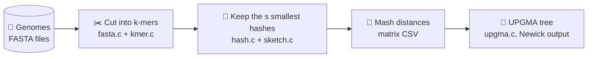
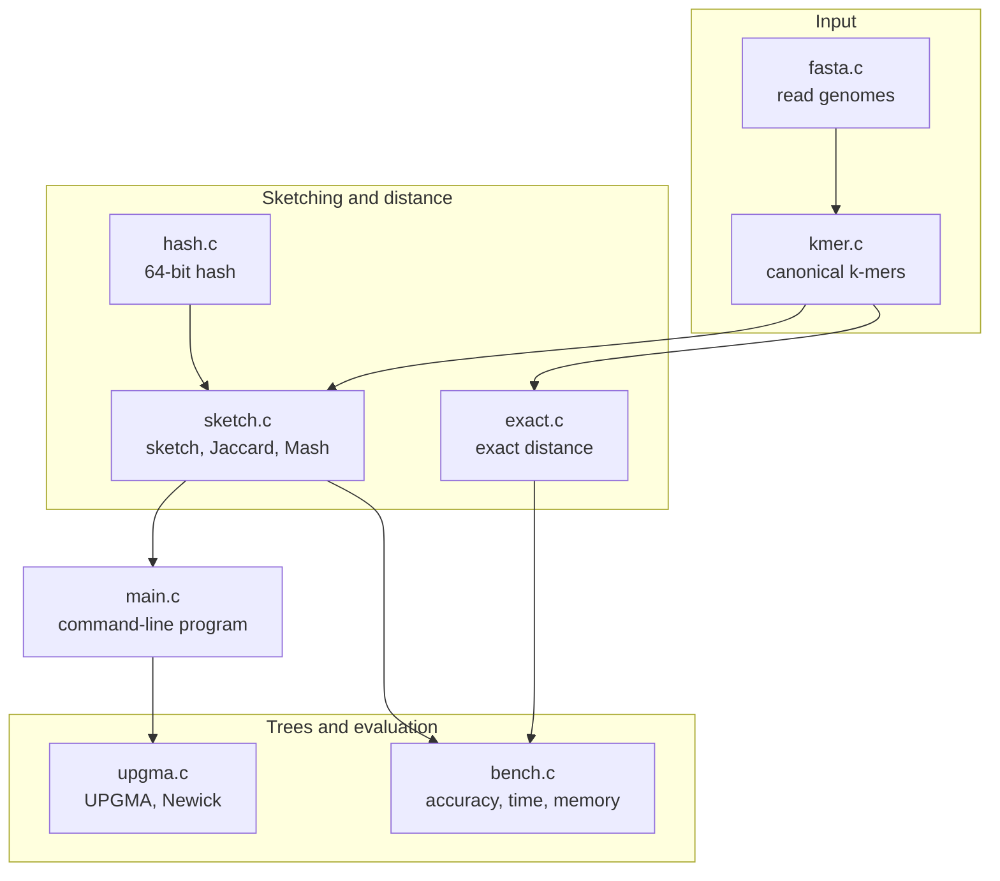
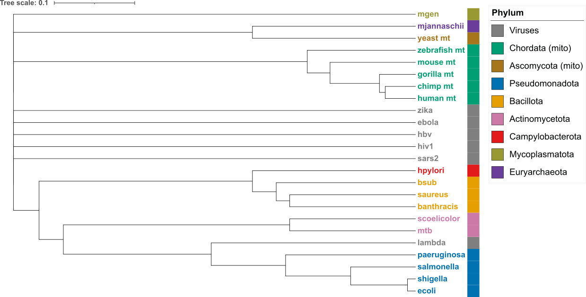

# 🧬 SketchTree-C

> Build a family tree of genomes in seconds, by comparing small **sketches** instead of whole genomes.


SketchTree-C reads genome files, shrinks each one into a tiny **MinHash sketch**, estimates how different every pair of genomes is, and draws the result as a **UPGMA tree**. It works on viruses, mitochondria, bacteria and archaea.

## At a glance



| | |
|---|---|
| **Input** | FASTA genome files (`.fna`) |
| **Output** | Distance matrix (CSV) and tree (Newick) |
| **k-mer length** | 1 to 31 (21 is a good default) |
| **Sketch size** | Any number (1000 is a good default) |
| **Dataset** | 24 genomes: viruses, mitochondria, bacteria, archaea |

## Quick start

```
git clone https://github.com/yyanup/sketchTree-C.git
cd sketchTree-C
gcc -std=c11 -O2 -Wall -Wextra -g -o sketchtree src/*.c -lm
./sketchtree dist data/taxonomy.csv data 21 1000 results/dist_sketch.csv
./sketchtree tree results/dist_sketch.csv results/tree.nwk
```

<details>
<summary><b>Windows (PowerShell) instructions</b></summary>

PowerShell does not expand `src/*.c`, so build with:

```
gcc -std=c11 -O2 -Wall -Wextra -g -o sketchtree (Get-ChildItem src\*.c) -lm
```

and run the program as `.\sketchtree.exe` instead of `./sketchtree`.

</details>

Open `results/tree.nwk` in [iTOL](https://itol.embl.de) (upload the file in your browser), FigTree or Dendroscope to see the tree.

## How it works, step by step

### 1. Cut each genome into k-mers

A **k-mer** is a short piece of DNA of length `k`. A sliding window moves along the sequence one base at a time (here `k = 3`):

```
Sequence:  A C G T A C G T

           A C G              ACG
             C G T              CGT
               G T A              GTA
                 T A C              TAC
                   A C G              ACG
                     C G T              CGT
```

DNA has two strands, so a k-mer and its **reverse complement** are the same piece of DNA seen from opposite sides. SketchTree-C stores both as one value, the **canonical k-mer** (the smaller of the two):

```
ACG  ── reverse complement ──►  CGT
 │                               │
 └────────  same DNA  ──────────┘      canonical k-mer = ACG
```

Bases that are not A, C, G or T (such as `N`) are skipped, and the window starts again after them.

### 2. Shrink the genome into a sketch

A bacterial genome has about 5 million k-mers. Each k-mer is turned into a number by a hash function, and only the **s smallest** hash values are kept:

```
All hashes of a genome:   9041  12  7733  47  3001  91  ...  (millions)
                                 │
                 sort, keep the s smallest
                                 ▼
Sketch (s = 5):          [ 12   47   91   130   202 ]
```

Two similar genomes contain many of the same k-mers, so they end up with many of the same small values.

### 3. Compare two sketches

Walk through both sketches from the smallest value and count how many values they share:

```
Sketch A:   12   47   91   130   202   ...
Sketch B:   12   47   88   130   205   ...
            ▲    ▲         ▲
            └────┴─────────┴── shared values

Jaccard similarity  j = shared values / values compared
Mash distance       D = −ln( 2j / (1 + j) ) / k
```

How `j` turns into a distance (for `k = 21`):

| Shared fraction `j` | Mash distance `D` | Meaning |
|---|---|---|
| 1.0 | 0 | identical k-mer content |
| 0.9 | 0.0026 | very close relatives |
| 0.5 | 0.019 | close relatives |
| 0.1 | 0.081 | distant relatives |
| 0 | 1 | nothing in common |

### 4. Build the tree with UPGMA

UPGMA repeatedly joins the two closest groups, then recalculates the distance from the new group to every other group. Example with 5 genomes:

```
Distance matrix              Tree
                                          ┌── A
    A  B  C  D  E                   ┌─────┤
A   0  2  4  6  6             ┌─────┤     └── B
B   2  0  4  6  6             │     │
C   4  4  0  6  6             │     └──────── C
D   6  6  6  0  2         ────┤
E   6  6  6  2  0             │           ┌── D
                              └───────────┤
                                          └── E

Newick: (((A:1,B:1):1,C:2):1,(D:1,E:1):2);
```

## Usage

```
sketchtree info   <fasta> <k>                                  genome length and k-mer count
sketchtree sketch <fasta> <k> <s> <out.sk>                     build and save one sketch
sketchtree dist   <taxonomy.csv> <data_dir> <k> <s> <out.csv>  distance matrix of all genomes
sketchtree tree   <matrix.csv> <out.nwk>                       UPGMA tree in Newick format
```

Example output of `info`:

```
$ ./sketchtree info data/ecoli.fna 21
File:    data/ecoli.fna
Name:    NC_000913.3
Length:  4641652 bases
k-mers:  4641632 (k=21)
```

Example output of `dist` (format only):

```
$ ./sketchtree dist data/taxonomy.csv data 21 1000 results/dist_sketch.csv
[1] lambda: 1000 hash values
[2] sars2: 1000 hash values
...
Distance matrix (24 x 24) written to results/dist_sketch.csv
```

## What you should see

| Pair | Expected distance |
|---|---|
| A genome with itself | 0 |
| Human and chimpanzee mitochondria | very small |
| *E. coli* and *Shigella* | small |
| *E. coli* and *Salmonella* | moderate |
| A virus and a bacterium | close to 1 |

## Data

The `data/` folder holds 24 NCBI RefSeq genomes and a table that describes them.

| Group | Genomes |
|---|---|
| 🦠 Viruses | phage lambda, SARS-CoV-2, HIV-1, hepatitis B, Ebola, Zika |
| 🧬 Mitochondria | human, chimpanzee, gorilla, mouse, zebrafish, yeast |
| 🧫 Bacteria | *E. coli* K-12, *Shigella flexneri*, *Salmonella enterica*, *Bacillus subtilis*, *Bacillus anthracis*, *Staphylococcus aureus*, *Mycobacterium tuberculosis*, *Pseudomonas aeruginosa*, *Helicobacter pylori*, *Streptomyces coelicolor*, *Mycoplasma genitalium* |
| 🔥 Archaea | *Methanocaldococcus jannaschii* |

To download the genomes again (PowerShell, from the project root):

```
powershell -ExecutionPolicy Bypass -File .\download_genomes.ps1
```

**`data/taxonomy.csv`** lists every file. The `dist` command reads the first column to find the genomes, and the genus and phylum columns are used to check nearest neighbours.

```
file,name,genus,phylum
ecoli.fna,Escherichia coli K-12,Escherichia,Pseudomonadota
```

## File formats

**Distance matrix (CSV):** a header `name,<genome1>,<genome2>,...`, then one row per genome that starts with its name.

```
name,A,B,C
A,0.000000,0.021840,1.000000
B,0.021840,0.000000,1.000000
C,1.000000,1.000000,0.000000
```

**Tree (Newick):** one line that ends with a semicolon, for example `((A:0.01,B:0.01):0.49,C:0.50);`.

## Architecture



```
SketchTree-C/
├── data/                 genomes (.fna) and taxonomy.csv
├── results/              distance matrices, trees, benchmark output
├── src/
│   ├── common.h          shared declarations for all modules
│   ├── fasta.c           FASTA reader
│   ├── kmer.c            canonical k-mer engine
│   ├── hash.c            64-bit hash function
│   ├── sketch.c          sketch building, saving, loading, distances
│   ├── exact.c           exact k-mer distance (ground truth)
│   ├── upgma.c           UPGMA clustering and Newick output
│   ├── bench.c           accuracy, time and memory benchmark
│   └── main.c            command-line program
├── download_genomes.ps1  downloads the genomes from NCBI
└── README.md
```

## Testing

| Check | Expected |
|---|---|
| `./sketchtree info data/lambda.fna 21` | 48,502 bases and 48,482 k-mers |
| `./sketchtree info data/ecoli.fna 21` | 4,641,652 bases and 4,641,632 k-mers |
| Genome compared with itself | distance 0 |
| Tiny input `ACGT`, `k = 3` | both k-mers map to the same canonical value |
| Input with an `N` | k-mers containing the `N` are skipped |

## Limitations

- `k` is limited to 31 so a k-mer fits in a 64-bit integer.
- Distances between distantly related genomes are less reliable, because they share few k-mers.
- A sketch is an estimate. A small `s` is fast but noisy.
- UPGMA assumes the same rate of change on every branch, so the tree is a quick summary and not a detailed evolutionary reconstruction.

## Results


Tree built from the distance matrix at `k = 21`, `s = 10000`. Colours show phylum.

### Settings compared

| Setting | What happened |
|---|---|
| `k=21, s=1000` | Clean, but most moderate relatives collapse to distance 1 |
| `k=15, s=10000` | Resolves more pairs, but unrelated genomes get chance matches (distances 0.2 to 0.57) |
| `k=21, s=10000` | Used for the figure: no chance matches, finer values |

### Selected distances (`k=21, s=10000`)

| Pair | Distance |
|---|---|
| *E. coli* and *Shigella* | 0.020 |
| *E. coli* and *Salmonella* | 0.162 |
| Human and chimpanzee mitochondria | 0.075 |
| Human and gorilla mitochondria | 0.088 |
| Human and mouse mitochondria | 0.211 |
| Human and zebrafish mitochondria | 0.258 |
| Any other virus and any other genome | 1.000 |

### What the tree shows

- Close relatives group correctly: the primate mitochondria, with mouse and zebrafish further out, and *E. coli*, *Shigella* and *Salmonella*.
- Genomes with nothing in common sit alone on long branches (the viruses and *M. genitalium*).
- Joins at distances above about 0.3 rest on one to seven shared hashes out of 10,000 and are not evolutionary signal. Examples are *H. pylori* joining the Bacillota and *M. jannaschii* pairing with the yeast mitochondrion.

### Benchmark

*Accuracy against sketch size, runtime and memory will be added from `results/benchmark.csv`.*
*To be filled in after the final run: tree screenshot, accuracy against sketch size, runtime and memory.*

## Reference

Ondov, B. D. et al. (2016). Mash: fast genome and metagenome distance estimation using MinHash. *Genome Biology*, 17, 132.